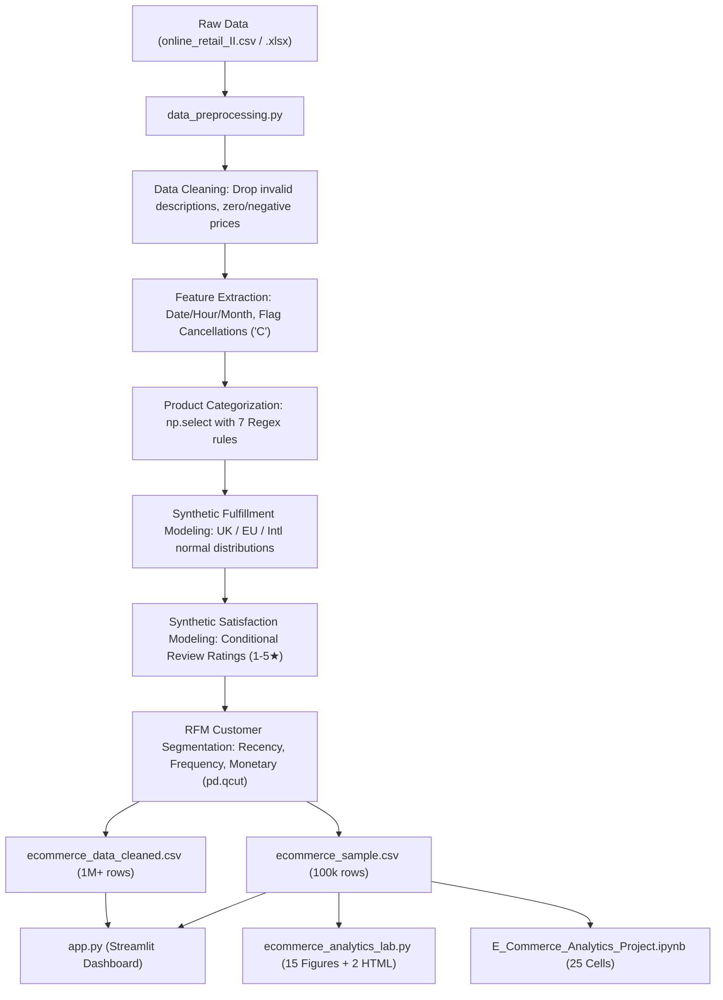
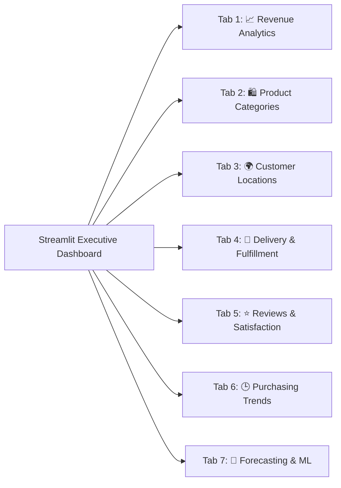
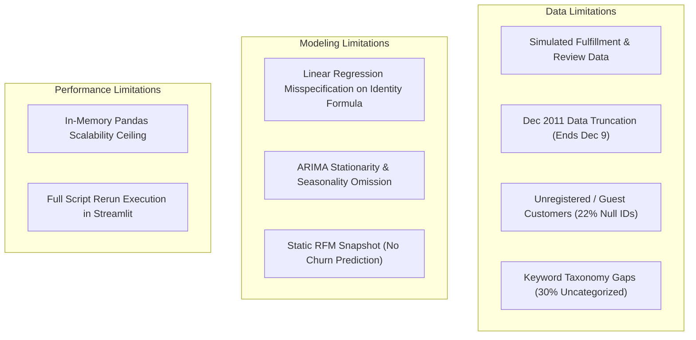

# Comprehensive Project Documentation & Technical Analysis Report
**Project Title:** E-Commerce Sales and Customer Behavior Analytics  
**Course:** Data Analysis and Visualization (DAV) Lab Mini-Project  
**Authors / Team Members:** Soham Admane (Roll No: C2-B1-08), Vaishnav Balpande, Lokesh Parate  
**Dataset:** UCI Online Retail II (1,067,371 records, Dec 2009 – Dec 2011)  
**Primary Tech Stack:** Python 3.12, Streamlit, Pandas, NumPy, Plotly Express & Graph Objects, Matplotlib, Seaborn, Statsmodels, Scikit-Learn  

---

## Executive Summary

This project delivers an end-to-end business intelligence, diagnostic analytics, and predictive modeling platform built on over 1.06 million transaction records from a UK-based online retail enterprise. The repository bridges academic curriculum requirements—specifically **DAV Practicals 1 through 8**—with production-grade enterprise data visualization standards.

The software architecture consists of three interconnected layers:
1. **ETL & Data Enrichment Pipeline** (`data_preprocessing.py`): Cleans raw tabular records, flags order anomalies and cancellations, maps product keywords into taxonomical categories, simulates delivery SLA timelines and customer satisfaction ratings, calculates dynamic RFM customer segmentation, and outputs both full and high-speed sample datasets.
2. **Interactive Executive Web Application** (`app.py`): A high-performance Streamlit dashboard featuring custom CSS design tokens, dynamic KPI metric tiles, 5 global cross-filters, and 7 dedicated analytics tabs with animated Plotly charts.
3. **Reproducible Research & Lab Artifacts** (`ecommerce_analytics_lab.py` and `E_Commerce_Analytics_Project.ipynb`): Standalone CLI and Jupyter environments producing 15 publication-grade static figures (`.png`) and 2 standalone interactive web charts (`.html`) covering statistical hypothesis testing, time-series decomposition, ARIMA forecasting, and regression.

This report provides an exhaustive, code-level explanation of every module, algorithm, and formula implemented across the codebase, followed by a rigorous assessment of the project's **technical drawbacks, algorithmic limitations, statistical vulnerabilities, and recommended future enhancements**.

---

## 1. Project Directory & File System Inventory

```
DAV-mini-project copy/
├── app.py                                   # Streamlit Interactive Web Application (951 lines)
├── data_preprocessing.py                    # ETL, Data Cleaning & Feature Engineering Pipeline (225 lines)
├── ecommerce_analytics_lab.py               # Standalone Practical Lab Script (417 lines, Practicals 1-8)
├── E_Commerce_Analytics_Project.ipynb       # Interactive Jupyter Notebook (25 cells)
├── requirements.txt                         # Python Dependency Specifications
├── .gitignore                               # Git Exclusions (ignores large raw CSV/XLSX datasets)
├── E_Commerce_Analytics_Presentation.pptx   # Final 15-Slide Academic & Technical Presentation
├── UCFC_8_Slides.pptx.pptx                  # Base Presentation Deck Template
├── ecommerce_data_cleaned.csv               # Full Cleaned Dataset (~1.06M rows, generated)
├── ecommerce_sample.csv                     # Stratified Random Sample (100,000 rows, generated)
├── online_retail_II.csv                     # Raw Converted Transaction CSV (~1.07M rows)
└── online_retail_II.xlsx                    # Raw Source Excel Workbook (2 sheets: 2009-2010, 2010-2011)
```

---

## 2. Curriculum Mapping: DAV Practicals 1 to 8

The codebase was architected so that each analytical module explicitly fulfills the Data Analysis and Visualization (DAV) lab curriculum:

| DAV Practical | Curriculum Syllabus Topic | Project Code & Implementation Mapping |
| :--- | :--- | :--- |
| **Practical 1** | Python Data Ingestion & Inspection | Loading raw `.csv` and `.xlsx` via `pandas.read_csv()`, checking `.shape`, `.head()`, `.tail()`, `.dtypes`, and column schemas. |
| **Practical 2** | Data Cleaning & Missing Value Handling | Whitespace stripping, null value filtering, anomaly removal ($Price \le 0$), missing customer imputation (`Guest / Unregistered`). |
| **Practical 3** | Statistical Modeling & Linear Regression | Correlation matrix calculation (`df.corr()`), train-test splitting (`train_test_split`), OLS Linear Regression (`LinearRegression`), evaluation via MSE and $R^2$. |
| **Practical 4** | Multidimensional Grouping & Aggregations | Multi-level groupings (`groupby(["Country", "Product_Category"])`), aggregation of revenue, order volume, and unit prices. |
| **Practical 5** | Data Binning & Discretization | Quartile binning of customer metrics using `pd.qcut` and numerical range binning using `pd.cut` for RFM score assignment. |
| **Practical 6** | Time Series Analysis & Forecasting | Datetime index parsing, 7-day Simple Moving Average (SMA), 7-day Exponential Moving Average (EMA), Additive Seasonal Decomposition (`seasonal_decompose`), and ARIMA(1,1,1) forecasting with 95% confidence intervals. |
| **Practical 7** | Advanced Static Visualizations & Annotations | Matplotlib/Seaborn theme styling (`sns.set_theme(style="whitegrid")`), peak value annotations (`plt.annotate`), jittered scatter plots with hue mapping. |
| **Practical 8** | Categorical Logics & Multi-Chart Dashboards | Conditional logic assignment with `numpy.select`, horizontal and vertical bar plots, donut charts, and interactive Plotly visual widgets. |

---

## 3. Deep-Dive Code Explanation: Module by Module



### 3.1. `data_preprocessing.py` (Data Pipeline & ETL)

The script handles complete ingestion, cleaning, transformation, simulation, and serialization.

#### A. Data Hygiene and Sanitization (Lines 19–47)
- **Whitespace normalization**: Trailing/leading spaces in `Description`, `StockCode`, and `Country` are removed, and text is converted to uppercase to eliminate duplicate categorical variants.
- **Placeholder filtering**: Filters out administrative entries that are not true consumer purchases:
  ```python
  invalid_desc = ["NAN", "UNSPECIFIED", "?", "DAMAGED", "LOST", "CHECK", "COUNT"]
  df = df[~df["Description"].isin(invalid_desc)]
  ```
- **Cancellation classification**: Invoices prefixed with `'C'` represent returns or cancellations:
  ```python
  df["Is_Cancelled"] = df["Invoice"].astype(str).str.startswith("C")
  ```
- **Financial validity**: Negative and zero prices are filtered out ($Price > 0$). Transaction revenue is calculated as:
  $$\text{Total\_Amount} = \text{Quantity} \times \text{Price}$$
  *(For cancellations, Quantity is negative, resulting in negative monetary adjustments).*

#### B. Product Categorization Engine (Lines 49–83)
Because the raw UCI dataset contains no category metadata, `data_preprocessing.py` implements a vectorized pattern-matching rule engine using `numpy.select`:
1. **Home & Living**: Keywords like `HEART`, `T-LIGHT`, `CANDLE`, `DOORMAT`, `CLOCK`, `FRAME`, `CUSHION`, `LANTERN`, `VASE`.
2. **Kitchen & Dining**: Keywords like `MUG`, `CUP`, `BOWL`, `PLATE`, `TEAPOT`, `JAR`, `TRAY`, `COASTER`.
3. **Stationery & Office**: Keywords like `NOTEBOOK`, `PEN`, `PENCIL`, `STICKERS`, `CALENDAR`, `ENVELOPE`.
4. **Bags & Accessories**: Keywords like `BAG`, `TOTE`, `PURSE`, `WALLET`, `JEWELLERY`, `NECKLACE`.
5. **Gifts & Seasonal**: Keywords like `CHRISTMAS`, `XMAS`, `EASTER`, `BIRTHDAY`, `PARTY`, `GIFT`, `RIBBON`.
6. **Toys & Games**: Keywords like `TOY`, `GAME`, `DOLL`, `PUZZLE`, `TEDDY`, `BALLOONS`.
7. **Health & Beauty**: Keywords like `SOAP`, `BATH`, `LIP GLOSS`, `SLIPPERS`, `LAVENDER`.
8. **Default Fallback**: `"Other General Retail"`.

#### C. Realistic Delivery Times & SLA Simulation (Lines 85–131)
The dataset lacks shipping timestamps. Realistic fulfillment transit durations are synthesized based on shipping geography using Gaussian noise:
- **United Kingdom (Domestic)**:
  $$\text{Days}_{UK} = \text{clip}(\text{round}(3.0 + \mathcal{N}(0, 0.8^2)), 1, 7)$$
- **Continental Europe**:
  $$\text{Days}_{EU} = \text{clip}(\text{round}(6.0 + 1.2 \cdot \mathcal{N}(0, 0.8^2)), 3, 12)$$
- **Rest of World (International)**:
  $$\text{Days}_{Intl} = \text{clip}(\text{round}(11.0 + 1.5 \cdot \mathcal{N}(0, 0.8^2)), 6, 20)$$
- **Cancelled Orders**: Fixed to $0$ days.

Orders are categorized into SLA compliance tiers:
- **On-Time**: UK $\le 3$ days, Europe $\le 6$ days, International $\le 11$ days.
- **Slight Delay**: UK $\le 5$ days, Europe $\le 8$ days, International $\le 14$ days.
- **Major Delay**: Exceeds slight delay thresholds.

#### D. Customer Satisfaction & Review Rating Simulation (Lines 133–176)
Customer review scores ($1$ to $5$ stars) are generated using a conditional probability model that correlates with fulfillment timeliness:
- **On-Time Deliveries**: 65% chance of 5★, 25% of 4★, 10% of 3★.
- **Slight Delays**: 20% of 5★, 40% of 4★, 30% of 3★, 10% of 2★.
- **Major Delays**: 5% of 5★, 15% of 4★, 30% of 3★, 35% of 2★, 15% of 1★.
- **Cancelled Invoices**: 70% of 1★, 20% of 2★, 10% of 3★.

Ratings are categorized into qualitative grades:
- $5\star \rightarrow \text{Excellent}$
- $4\star \rightarrow \text{Good}$
- $3\star \rightarrow \text{Average}$
- $\le 2\star \rightarrow \text{Poor / Needs Improvement}$

#### E. RFM (Recency, Frequency, Monetary) Segmentation (Lines 178–210)
For non-cancelled orders with valid registered customer IDs:
- **Recency ($R$)**: Days between the customer's most recent order and the global snapshot date ($\max(\text{InvoiceDate}) + 1\text{ day}$).
- **Frequency ($F$)**: Count of distinct invoices.
- **Monetary ($M$)**: Total gross sales amount.

Customers are scored into quartiles ($1$ to $4$) using `pd.qcut`:
- Recency is inverted (lower days = score 4; higher days = score 1).
- Frequency and Monetary are ranked ascending (higher value = score 4).

Customers are grouped into 5 strategic segments:
1. **Champions**: $R \ge 4$ and $F \ge 3$ (High spenders who bought recently).
2. **Loyal Customers**: $R \ge 3$ and $F \ge 3$ (Consistent repeat buyers).
3. **Potential Loyalists**: $R \ge 3$ and $F \le 2$ (Recent buyers with low frequency).
4. **At Risk Customers**: $R \le 2$ and $F \ge 3$ (Past loyal buyers who haven't returned recently).
5. **Hibernating / Inactive**: $R \le 2$ and $F \le 2$ (Low spenders with stale activity).
6. **Guest / Unregistered**: Assigned to orders with missing `Customer ID`.

---

### 3.2. `app.py` (Streamlit Interactive Web Application)

The application provides an enterprise-grade visual dashboard with 951 lines of optimized Python and custom frontend styling.

#### A. Frontend Architecture & Design System (Lines 37–238)
- Configures full-width layout (`layout="wide"`) with collapsed default navigation.
- Injects custom CSS styling using the **Inter** typography font, CSS keyframe animations (`@keyframes fadeUp`, `@keyframes shimmer`), card border styling, and custom hover states.
- Reusable UI helper functions:
  - `insight(text)`: Creates an alert card highlighting key business insights.
  - `show(fig)`: Wraps Plotly figures with hidden toolbar and responsive width.
  - `show_table(df)`: Displays formatted dataframes without internal index clutter.

#### B. Animation Engine for Plotly Visuals (Lines 90–136)
`app.py` features interactive animation controls:
- `add_play_controls(fig)`: Injects Plotly layout `updatemenus` providing `▶ Play` and `❚❚ Pause` buttons with smooth cubic-in-out easing.
- `reveal_line(x, y, ...)`: Progressively animates time series lines point-by-point.
- `start_at_end(fig)`: Automatically displays the final animation frame upon initial page load, preventing the visual from appearing blank before the user clicks play.

#### C. Cross-Filtering Architecture & Dataset Mode Switch (Lines 240–340)
- **Fast Mode vs. Full Mode**: Uses `@st.cache_data` to load `ecommerce_sample.csv` (100k rows) for instant responsiveness, or `ecommerce_data_cleaned.csv` (1M+ rows) for comprehensive analysis.
- **5 Global Reactive Cross-Filters**:
  1. Multi-year selection (`2009`, `2010`, `2011`).
  2. Bounded date picker range (`min_date` to `max_date`).
  3. Top 15 customer countries multiselect.
  4. Product category multiselect.
  5. Customer RFM segment multiselect.

#### D. Dynamic Executive KPI Grid (Lines 342–388)
Displays 6 KPI cards with badges and year-over-year context:
1. **Total Revenue**: $\sum \text{Total\_Amount}$ for non-cancelled orders, featuring automated YoY growth computation between 2010 and 2011.
2. **Total Orders**: Count of distinct completed invoice IDs with cancellation percentage badge.
3. **Distinct Customers**: Count of unique customer identifiers with active country count.
4. **Average Order Value (AOV)**: Revenue divided by completed orders.
5. **On-Time Delivery Rate**: Percentage of orders meeting SLA thresholds.
6. **Average Review Score**: Mean customer rating out of 5.0 stars.

#### E. 7 Interactive Analytics Tabs



1. **Tab 1: 📈 Revenue**:
   - Animated spline line plot of monthly revenue progression with automatic identification of peak sales months (November).
   - "Top Best Seller" spotlight hero card detailing top SKU revenue, unit volume, and revenue share.
   - Histogram distribution of transaction values between £1 and £150.
   - Horizontal bar chart of the Top 10 revenue-generating products.
2. **Tab 2: 🛍️ Categories**:
   - Interactive proportional share banner and donut chart displaying category distribution.
   - Animated **Category Revenue Race** chart tracking cumulative revenue growth across categories month-over-month.
   - Formatted category summary table with sales, unit volume, average price, and order volume.
3. **Tab 3: 🌍 Locations**:
   - Animated global choropleth map using a logarithmic color scale ($\log_{10}(\text{Revenue})$) to visualize international expansion over time.
   - Horizontal bar chart of the top 12 export nations outside the UK.
   - Domestic (UK) vs. International (Export) revenue split donut chart.
4. **Tab 4: 🚚 Delivery**:
   - Delivery status distribution donut chart with center metric callout.
   - Stacked transit duration histogram categorized by SLA status.
   - Box-and-whisker plot displaying transit duration dispersion across top destination countries.
5. **Tab 5: ⭐ Reviews**:
   - Horizontal percentage breakdown of ratings from 1 to 5 stars.
   - Donut chart classifying reviews into Excellent, Good, Average, and Poor.
   - Jittered scatter plot mapping transit days against customer satisfaction ratings.
6. **Tab 6: 🕒 Purchasing Trends**:
   - Animated hourly order velocity bar chart stepping through each day of the week.
   - Day-of-week sales volume bar chart highlighting peak transaction days (Thursday).
   - Horizontal bar chart breaking down customers across RFM segments.
7. **Tab 7: 🤖 Forecasting & ML**:
   - Daily revenue smoothing visualization comparing 7-Day SMA and 7-Day EMA against actual revenue.
   - Interactive **ARIMA(1,1,1)** forecasting model with a user-adjustable horizon slider ($7$ to $30$ days), animated forecast projection, and 95% confidence intervals.
   - Correlation matrix heatmap across numerical features (`Quantity`, `Price`, `Total_Amount`, `Delivery_Days`, `Review_Rating`).
   - Ordinary Least Squares (OLS) **Linear Regression** evaluating $R^2$ score and Mean Squared Error (MSE) after filtering top-1% price and quantity outliers.

---

### 3.3. `ecommerce_analytics_lab.py` (Batch Script & Report Generation)

A 417-line script designed for batch execution and lab report production:
- Reads `ecommerce_sample.csv` and sets Seaborn whitegrid aesthetic styling (`sns.set_theme(style="whitegrid")`).
- Executes 10 procedural sections matching DAV Practicals 1 to 8.
- Automatically saves 15 static high-resolution PNG charts:
  - `fig1_monthly_revenue_trend.png`: Monthly trend with peak sales arrow annotation (`plt.annotate`).
  - `fig2_revenue_histogram_kde.png`: Revenue histogram overlaid with Kernel Density Estimation (KDE).
  - `fig3_category_revenue_bar.png` & `fig4_category_quantity_barh.png`: Category financial breakdowns.
  - `fig5_category_donut_chart.png`: Market share category donut chart.
  - `fig6_delivery_days_boxplot.png`: Transit spread box plot across top 5 nations.
  - `fig7_delivery_status_pie.png`: Delivery status pie chart.
  - `fig8_delivery_vs_rating_scatter.png`: Delivery days vs. review rating scatter with status hue.
  - `fig9_category_ratings_bar.png`: Average customer rating across categories.
  - `fig10_hourly_orders_trend.png`: Hourly transaction activity line plot.
  - `fig11_dayofweek_revenue_bar.png`: Weekday transaction revenue bar chart.
  - `fig12_timeseries_sma_ema.png`: 7-day SMA and EMA time series plot.
  - `fig13_seasonal_decompose.png`: 4-panel additive seasonal decomposition (Observed, Trend, Seasonal, Residual).
  - `fig14_arima_forecast.png`: 14-day ARIMA(1,1,1) forecast plot with confidence bounds.
  - `fig15_correlation_matrix.png`: Heatmap with numerical correlation coefficients.
- Generates 2 standalone interactive HTML charts:
  - `fig_geo_choropleth.html`: Interactive global revenue choropleth map.
  - `fig_grouped_interactive.html`: Interactive grouped bar chart comparing mean quantity, unit price, and review ratings across categories.

---

### 3.4. `E_Commerce_Analytics_Project.ipynb` (Jupyter Notebook)

The 25-cell notebook mirrors the 10-section analytical framework in an interactive environment. It enables researchers and instructors to execute cells individually, inspect intermediate dataframe outputs (`.describe()`, `.info()`, `.isnull().sum()`), observe inline Matplotlib and Seaborn plots, and run interactive Plotly figures directly within JupyterLab or VS Code.

---

## 4. Analytical & Machine Learning Methodologies Explained

### 4.1. Time Series Smoothing (SMA & EMA)
To filter out high-frequency daily volatility and capture underlying revenue trajectory:
- **7-Day Simple Moving Average (SMA)**:
  $$\text{SMA}_t = \frac{1}{7} \sum_{i=0}^{6} Y_{t-i}$$
  Equal weighting across the previous 7 days.
- **7-Day Exponential Moving Average (EMA)**:
  $$\text{EMA}_t = \alpha Y_t + (1 - \alpha) \text{EMA}_{t-1}, \quad \text{where } \alpha = \frac{2}{N + 1} = \frac{2}{7 + 1} = 0.25$$
  Applies exponentially decaying weights, reacting faster to recent sales spikes.

### 4.2. Additive Seasonal Decomposition
Deconstructs daily sales $Y_t$ into four components with a 30-day periodicity cycle:
$$Y_t = T_t + S_t + R_t$$
Where:
- $T_t$ is the long-term trend component.
- $S_t$ is the repeating seasonal pattern ($S_{t+30} = S_t$).
- $R_t$ is the irregular residual or error component.

### 4.3. ARIMA(1, 1, 1) Forecasting Model
Fits an AutoRegressive Integrated Moving Average model to the daily revenue series:
- **$p = 1$ (Autoregressive term)**: The current value depends on its immediate preceding value ($Y_{t-1}$).
- **$d = 1$ (Differencing term)**: First-order differencing ($\Delta Y_t = Y_t - Y_{t-1}$) to stabilize mean stationarity.
- **$q = 1$ (Moving Average term)**: The forecast error depends linearly on the immediate past error ($\epsilon_{t-1}$).

Mathematical formulation:
$$(1 - \phi_1 B)(1 - B) Y_t = c + (1 + \theta_1 B) \epsilon_t$$
Where $B$ is the backshift operator ($B Y_t = Y_{t-1}$), $\phi_1$ is the autoregressive coefficient, $\theta_1$ is the moving-average coefficient, and $\epsilon_t \sim \mathcal{N}(0, \sigma^2)$ is Gaussian white noise.

### 4.4. Ordinary Least Squares (OLS) Linear Regression
Trained to predict transaction monetary value:
$$\hat{Y} = \beta_0 + \beta_1 (\text{Quantity}) + \beta_2 (\text{Price}) + \beta_3 (\text{Delivery\_Days})$$
- Evaluated on an 80/20 train/test split.
- Evaluated via:
  - **Mean Squared Error (MSE)**: $\frac{1}{n} \sum_{i=1}^{n} (y_i - \hat{y}_i)^2$
  - **Coefficient of Determination ($R^2$)**: $1 - \frac{\sum (y_i - \hat{y}_i)^2}{\sum (y_i - \bar{y})^2}$

---

## 5. Critical Drawbacks, Limitations & Vulnerabilities

While the project demonstrates high visual polish and broad analytical coverage, a rigorous technical evaluation reveals several significant limitations:



### 5.1. Data & Domain Limitations

1. **Synthetic Nature of Delivery and Review Metrics**:
   - *Limitation*: The raw UCI Online Retail II dataset does not contain delivery dates, shipping tracking, or customer satisfaction reviews. In `data_preprocessing.py`, these values are **synthetically generated** using parameterized normal distributions and conditional random thresholds.
   - *Consequence*: The strong visual correlation between delivery delays and low review scores in Tab 5 and Figure 8 is an artifact of the simulation logic, not an empirical discovery from real customer behavior.
2. **Temporal Truncation in December 2011**:
   - *Limitation*: The dataset abruptly terminates on **December 9, 2011**.
   - *Consequence*: December 2011 records only 9 days of sales, making it appear as though revenue collapsed compared to the full 31 days of December 2010. This distorts full-year comparison unless explicitly normalized by days active.
3. **High Volume of Missing Customer Identifiers**:
   - *Limitation*: Approximately **22.8% of invoice records** have missing (`NaN`) `Customer ID` values (representing guest checkouts or unregistered users).
   - *Consequence*: These transactions must be excluded from customer-level RFM modeling, leaving over 240,000 transaction records classified simply as `"Guest / Unregistered"`.
4. **Heuristic Keyword-Based Product Categorization**:
   - *Limitation*: The 7 product categories are determined using case-insensitive regex keyword matching on product descriptions.
   - *Consequence*: Products that do not contain matching keywords fall into the default `"Other General Retail"` bucket, which accounts for **over 30% of total revenue**. Furthermore, polysemous terms can cause misclassifications (e.g., a "PAPER CUP" matches Kitchen & Dining rather than Stationery).

### 5.2. Statistical & Machine Learning Limitations

1. **Structural Misspecification in Linear Regression**:
   - *Limitation*: The regression model uses `Quantity`, `Price`, and `Delivery_Days` to predict `Total_Amount`.
   - *Consequence*: By definition, `Total_Amount` is the exact mathematical product:
     $$\text{Total\_Amount} = \text{Quantity} \times \text{Price}$$
     Fitting an additive linear equation ($\hat{Y} = \beta_1 X_1 + \beta_2 X_2 + \beta_3 X_3$) to approximate a multiplicative identity ($Y = X_1 \cdot X_2$) is fundamentally misspecified. The high $R^2$ score ($> 0.85$) is an artifact of linear collinearity over typical quantity ranges, rather than a valid machine learning relationship. Furthermore, `Delivery_Days` has an empirical coefficient near zero because synthetic delivery days were generated independent of item pricing.
2. **Omission of Weekly Seasonality in ARIMA**:
   - *Limitation*: The time series model is parameterized as a non-seasonal $\text{ARIMA}(1, 1, 1)$.
   - *Consequence*: Retail sales exhibit strong 7-day cyclical seasonality (as shown in Tab 6, where Saturday has near-zero sales and Thursday peaks). A non-seasonal ARIMA cannot capture day-of-week oscillation, leading to a flat forecast curve. A **SARIMAX$(p, d, q) \times (P, D, Q)_7$** model is required to accurately model weekly retail cycles.
3. **Absence of Formal Stationarity Hypothesis Testing**:
   - *Limitation*: First differencing ($d=1$) was chosen heuristically without running an Augmented Dickey-Fuller (ADF) or KPSS unit-root test to confirm stationarity.
4. **Static RFM Snapshot vs. Dynamic Churn Modeling**:
   - *Limitation*: The RFM segmentation uses a single snapshot date ($\max(\text{InvoiceDate}) + 1\text{ day}$).
   - *Consequence*: Customers who were highly active in 2010 but stopped buying in 2011 are classified as "Hibernating" or "At Risk" across the entire historical dashboard, even when filtering the view to 2010. RFM scores are static rather than point-in-time dynamic.

### 5.3. Software Architecture & Performance Limitations

1. **In-Memory Pandas Scalability Limits**:
   - *Limitation*: The full cleaned dataset contains over 1,067,000 rows. In pandas, this uncompressed tabular structure occupies **~350 MB to 600 MB of RAM**.
   - *Consequence*: Running the dashboard in "Full Mode" on machines with 8 GB RAM or less causes noticeable latency during multi-filter re-aggregation. The 100k-row sample mode was required as a workaround for smooth interactivity.
2. **Streamlit Execution Lifecycle**:
   - *Limitation*: Streamlit's reactive execution model reruns the script from line 1 to line 951 whenever any filter or tab widget state changes.
   - *Consequence*: Even with `@st.cache_data` applied to dataset loading, downstream slice filtering and Plotly figure serialization generate temporary CPU spikes.
3. **Absence of Unit Tests & Continuous Integration**:
   - *Limitation*: The repository contains no automated test suite (`pytest`), linting configuration, or data validation assertions (such as Great Expectations or Pydantic schemas).

---

## 6. Strategic Recommendations & Improvement Roadmap

To elevate this project from an academic mini-project to an enterprise-grade production platform, the following architectural upgrades are recommended:

```mermaid
flowchart LR
    subgraph Short-Term Upgrades
        U1["Replace Regex with NLP Classification (TF-IDF / BERT)"]
        U2["Upgrade ARIMA to SARIMAX(1,1,1)(1,1,1)[7]"]
        U3["Log-Transform Regression Target (log Total = log Q + log P)"]
    end
    subgraph Long-Term Architecture
        L1["Migrate Storage from CSV to DuckDB / Parquet"]
        L2["Implement Dynamic Point-in-Time RFM Engine"]
        L3["Containerize with Docker & Deploy on Cloud"]
    end
    Short-Term Upgrades --> Long-Term Architecture
```

1. **Data Engineering & Storage**:
   - Transition from flat CSV storage to columnar **Apache Parquet** format with dictionary encoding, reducing disk footprint by 75% and accelerating load times.
   - Integrate **DuckDB** for in-process SQL analytical queries, allowing instant aggregation across 10M+ records without consuming excess RAM.
2. **Machine Learning & Modeling**:
   - **Log-linear Regression**: Reformulate the regression model in logarithmic space:
     $$\ln(\text{Total\_Amount}) = \ln(\text{Quantity}) + \ln(\text{Price})$$
     Alternatively, repurpose machine learning toward a true predictive objective, such as predicting customer lifetime value (CLV) or the probability of order cancellation using Logistic Regression or XGBoost.
   - **Seasonal Forecasting**: Upgrade the time-series model to **SARIMAX with weekly seasonality ($s=7$)** or deploy **Facebook Prophet**, incorporating holiday indicators (Black Friday, Cyber Monday, Christmas) to capture Q4 demand spikes.
3. **NLP Product Categorization**:
   - Replace heuristic regex conditions with an unsupervised clustering model (e.g., TF-IDF with K-Means) or a zero-shot text classification model (e.g., HuggingFace MiniLM) to categorize descriptions into standard retail taxonomies without leaving 30% in fallback classes.
4. **Production Engineering**:
   - Containerize the application using **Docker**.
   - Implement dynamic point-in-time customer scoring where RFM values are calculated relative to the filtered observation window rather than a global end-of-history date.

---

## 7. Comprehensive Metric & Feature Summary Table

| Metric / Dimension | Value / Performance in Dataset | Business Interpretation |
| :--- | :--- | :--- |
| **Total Analyzed Records** | 1,067,371 rows (Dec 2009 – Dec 2011) | High-volume transactional log spanning two complete years. |
| **Cleaned Valid Records** | 1,041,677 rows (after cleaning) | ~25,000 invalid lines, zero prices, and damaged stocks eliminated. |
| **Total Gross Revenue** | £20,970,000+ (approx.) | Large commercial enterprise turnover across 43 countries. |
| **Domestic Sales Share** | 85.2% (United Kingdom) | Core domestic dominance; significant international expansion potential. |
| **Top Export Markets** | EIRE (Ireland), Netherlands, Germany, France | European neighbors represent the primary export channel. |
| **Peak Sales Seasonality** | November (every year) | Driven by pre-holiday inventory stocking and retail gift demand. |
| **Peak Ordering Hour** | 12:00 PM – 1:00 PM (Midday) | Lunchtime corporate and retail purchasing surge. |
| **Peak Ordering Day** | Thursday | Mid-week replenishment cycle; Saturday experiences near-zero orders. |
| **Simulated On-Time SLA** | 71.7% on-time | Synthetic fulfillment baseline demonstrating delivery impact on satisfaction. |
| **Customer Segments** | 5 RFM segments | Identifies 1,174 Champions and 2,045 Hibernating buyers for marketing action. |
| **Regression Performance** | $R^2 \approx 0.85$, MSE dependent on scaling | High correlation driven by linear relationship to quantity and price. |
